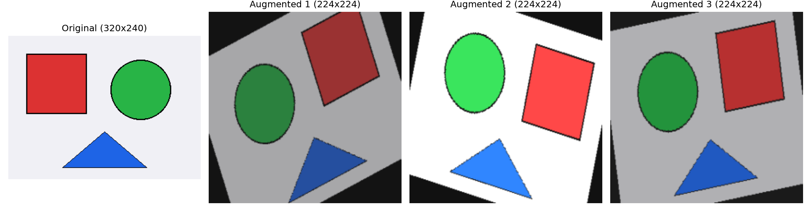

# Computer Vision Foundations

Repository dedicato ai fondamenti di Computer Vision e manipolazione tensoriale in PyTorch: esplorazione del layout di memoria delle immagini, normalizzazione statistica e pipeline di data augmentation con accelerazione hardware CUDA.

---

## 🛠️ Stack Tecnologico & Hardware

* **Linguaggio & Framework:** Python 3.11, PyTorch (CUDA 12.4), Torchvision
* **Elaborazione Immagini:** OpenCV, Pillow, NumPy, Matplotlib
* **Hardware di Riferimento:** NVIDIA GeForce RTX 3050 Ti Laptop GPU (4 GB VRAM)

---

## 📁 Struttura del Progetto

```text
computer-vision-starter/
├── assets/          # Immagini di test, grafici e output visivi
├── data/            # Dataset locali (esclusi da git)
├── models/          # Checkpoint e pesi locali (esclusi da git)
├── notebooks/       # Notebook interattivi (.ipynb)
├── src/             # Codice sorgente Python
│   ├── __init__.py
│   └── milestone_0_exploration.py
├── .gitignore       # Regole di esclusione git
├── requirements.txt # Dipendenze del progetto
└── README.md
```

---

## 🔬 Milestone 0: Fondamenti & Esplorazione Tensoriale

* Verifica dell'ambiente PyTorch e rilevamento della GPU dedicata (CUDA 12.4).
* Gestione dei layout di memoria: conversione da *Channels-Last* `(H, W, C)` (NumPy/PIL) a *Channels-First* `(C, H, W)` (PyTorch).
* Normalizzazione dei canali RGB con statistiche ImageNet ($\mu$, $\sigma$).
* Aggiunta della dimensione di Batch `(B, C, H, W)` e allocazione in memoria VRAM.
* Pipeline di **Data Augmentation**: rotazione casuale, horizontal flip e color jittering con resize a $224 \times 224$.



---

## 💻 Installazione & Esecuzione

1. **Clonare il repository e creare l'ambiente virtuale:**
   ```powershell
   git clone https://github.com/JCicconi-31/Computer-Vision-Deep-Learning.git
   cd computer-vision-starter
   python -m venv .venv
   .\.venv\Scripts\Activate.ps1
   ```

2. **Installare PyTorch (con supporto CUDA) e le dipendenze:**
   ```powershell
   pip install --upgrade pip
   pip install torch torchvision --index-url https://download.pytorch.org/whl/cu124
   pip install -r requirements.txt
   ```

3. **Eseguire lo script di esplorazione:**
   ```powershell
   python src/milestone_0_exploration.py
   ```
